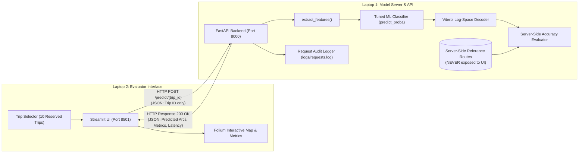

# PathSnap: Distributed Map-Matching & Route Reconstruction

PathSnap is an end-to-end, distributed machine learning system that reconstructs vehicle trajectories by matching noisy GPS observations to a road network. The project couples a candidate classification model with a Hidden Markov Model (HMM) and Viterbi decoder to recover continuous road segments from sparse, noisy trajectories. 

The system is deployed in a **distributed two-laptop architecture**:
- **Laptop 1 (Backend & Model Host)**: FastAPI service executing data extraction, feature generation, model probability inference, log-space Viterbi decoding, and server-side evaluation.
- **Laptop 2 (Evaluator UI)**: Client interface that enables an evaluator to select any of the 10 reserved evaluation trips, query Laptop 1 over the local network, and visualize the reconstructed route against interactive Folium maps with precision metrics.

---

## Technical Work Split & Team Roles

| Member | Track | Primary Deliverables | Report Sections |
| :--- | :--- | :--- | :--- |
| **Person 1** | **Data, Features & Candidates** | Clean data pipeline, spatial candidate generation, leak-free feature table, trip-grouped CV folds, 2 baseline models (`Linear`, `KNN`) | Section 2 (EDA & Features) |
| **Person 2** | **Model Experimentation & Bayesian Optimization** | Group-aware CV evaluation harness, 3 models (`RF`, `Boosting`, `MLP`), Bayesian hyperparameter tuning (Optuna), serialized model artifacts | Sections 3 & 4 (Models & Tuning) |
| **Person 3** | **HMM/Viterbi & Route Evaluation** | Log-space Viterbi decoder, emission/transition probability formulation, route continuity metrics, interactive Folium prediction maps | Sections 5 & 6 (HMM & Visualization) |
| **Person 4** | **API, UI, Deployment & Integration** | FastAPI backend (`Laptop 1`), Evaluator UI (`Laptop 2`), two-laptop networking/scripts, request audit logs, repo & PDF report assembly | Section 7 (Deployment & UI) + Assembly |

---

## System Architecture



---

## Repository Directory Structure

```
PathSnap/
├── .gitignore                      # Git ignore patterns for virtualenv, caches, and raw data
├── README.md                       # Main project documentation and run guide
├── requirements.txt                # Unified dependency list
│
├── api/                            # [Person 4] FastAPI Server (Laptop 1)
│   ├── __init__.py
│   ├── main.py                     # FastAPI application entrypoint (/health, /trips, /predict/{trip_id})
│   ├── config.py                   # Server configuration and environment settings
│   ├── schemas.py                  # Pydantic request and response contracts
│   ├── pipeline.py                 # End-to-end inference pipeline and server-side evaluation
│   ├── logger.py                   # Timestamped evaluator audit logging
│   └── logs/                       # Request logs directory
│
├── ui/                             # [Person 4] Evaluator Frontend (Laptop 2)
│   ├── __init__.py
│   ├── app.py                      # Interactive Streamlit dashboard for evaluators
│   └── README.md                   # UI execution instructions
│
├── deploy/                         # [Person 4] Deployment & Two-Laptop Networking
│   ├── README.md                   # Network configuration (LAN/Hotspot), firewall, IP binding
│   ├── run_laptop1_api.bat         # 1-click startup for Laptop 1 (Windows)
│   ├── run_laptop1_api.sh          # 1-click startup for Laptop 1 (Unix/macOS)
│   ├── run_laptop2_ui.bat          # 1-click startup for Laptop 2 (Windows)
│   └── run_laptop2_ui.sh           # 1-click startup for Laptop 2 (Unix/macOS)
│
├── data/                           # [Person 1] Data Loading, Cleaning & Preprocessing
│   ├── __init__.py
│   ├── loader.py                   # Parsers for .track, .nodes, .arcs, .route
│   ├── preprocessor.py             # Coordinate conversions (projected/geodesic) & gap analysis
│   ├── inventory.py                # Dataset inspection and inventory generator
│   ├── data_quality_log.md         # Anomaly records, CRS justification, and missing values
│   ├── raw/                        # Extracted raw trip folders (.track, .nodes, .arcs, .route)
│   └── processed/                  # Processed candidate tables and CV fold mappings
│
├── features/                       # [Person 1] Candidate Generation & Feature Extraction
│   ├── __init__.py
│   ├── spatial_index.py            # Spatial indexing (KDTree/BallTree) for candidate arcs
│   ├── candidate_generator.py      # Radius candidate generation & candidate miss rate tracking
│   ├── feature_engineering.py      # Feature engineering (distance, heading, velocity, context)
│   └── extract_features.py         # FROZEN inference-time feature function (shared by API)
│
├── models/                         # [Person 2] Serialized Models & Preprocessing Artifacts
│   ├── __init__.py
│   ├── loader.py                   # predict_proba wrapper and model loader
│   ├── config.yaml                 # Final model configuration and hyperparameter records
│   └── saved/                      # Model binaries (.joblib / .pkl)
│
├── experiments/                    # [Person 2] Evaluation Harness & Multi-Model Training
│   ├── __init__.py
│   ├── harness.py                  # Group-aware cross-validation harness (80 train trips)
│   ├── metrics.py                  # Top-1 accuracy, Macro F1, Log Loss, Confusion Matrix
│   ├── train_model1_linear.py      # Model 1: Logistic Regression / Linear SVM
│   ├── train_model2_knn.py         # Model 2: Distance-Weighted KNN
│   ├── train_model3_rf.py          # Model 3: Random Forest Classifier
│   ├── train_model4_boosting.py    # Model 4: Gradient Boosting / LightGBM
│   ├── train_model5_mlp.py         # Model 5: Multi-Layer Perceptron (Neural Network)
│   └── results/                    # CSV comparison tables and evaluation logs
│
├── tuning/                         # [Person 2] Bayesian Hyperparameter Optimization
│   ├── __init__.py
│   ├── bayesian_opt.py             # Optuna optimization study with group-aware CV
│   ├── search_space.py             # Defined parameter spaces for Bayesian search
│   └── trials/                     # Trial history and convergence logs
│
├── hmm/                            # [Person 3] HMM & Viterbi Route Reconstruction
│   ├── __init__.py
│   ├── viterbi.py                  # Log-space Viterbi algorithm recurrence implementation
│   ├── emissions.py                # Emission probabilities from classifier probabilities
│   ├── transitions.py              # Transition probabilities from network connectivity
│   ├── decoder.py                  # decode(trip_candidates, probabilities) interface
│   └── config.yaml                 # Decoder hyperparameters (weights, gap thresholds)
│
├── evaluation/                     # [Person 3] Route Evaluation & Comparison
│   ├── __init__.py
│   ├── route_metrics.py            # Pointwise Top-1, sequence accuracy, route continuity
│   └── compare_routes.py           # Classifier-only vs Classifier+HMM benchmark
│
├── maps/                           # [Person 3] Folium Map Visualization
│   ├── __init__.py
│   ├── folium_generator.py         # Multi-layer Folium map generator with layer controls
│   └── html/                       # Exported interactive HTML maps
│
├── notebooks/                      # Exploratory Data Analysis & Notebooks
│   ├── README.md                   # Notebook documentation
│   └── 01_exploratory_data_analysis.ipynb
│
├── docs/                           # Documentation & Guidelines
│   ├── guidelines/                 # Event PDF guidelines
│   ├── INTERFACES.md               # Cross-track contract definitions
│   └── SYSTEM_ARCHITECTURE.md      # Distributed deployment details
│
└── tests/                          # Automated Unit & Integration Tests
    ├── __init__.py
    ├── test_api.py                 # FastAPI endpoint tests
    └── test_pipeline.py            # Pipeline integration tests
```

---

## Installation & Setup

### Prerequisites
- Python 3.10+ (tested on Python 3.10 and 3.11)
- Git

### 1. Clone the Repository
```bash
git clone https://github.com/Raghunandan-Kotary/PathSnap.git
cd PathSnap
```

### 2. Set Up Virtual Environment
```bash
# Windows
python -m venv .venv
.venv\Scripts\activate

# Linux / macOS
python3 -m venv .venv
source .venv/bin/activate
```

### 3. Install Dependencies
```bash
pip install --upgrade pip
pip install -r requirements.txt
```

---

## Two-Laptop Distributed Run Instructions

### Step 1: Laptop 1 (Model Host & FastAPI Server)
1. Ensure Laptop 1 and Laptop 2 are connected to the same Wi-Fi network (or a dedicated mobile hotspot).
2. Obtain Laptop 1's local IPv4 address:
   ```cmd
   ipconfig
   # Look for "IPv4 Address", e.g. 192.168.1.45
   ```
3. Start the FastAPI server (bound to `0.0.0.0` so it accepts remote requests):
   ```cmd
   # Option A: Windows batch script
   deploy\run_laptop1_api.bat

   # Option B: Direct uvicorn command
   uvicorn api.main:app --host 0.0.0.0 --port 8000 --reload
   ```
4. Verify the server is running locally:
   - Open browser at `http://localhost:8000/docs` (Swagger UI).
   - Check `http://localhost:8000/health`.

### Step 2: Laptop 2 (Evaluator UI)
1. Open terminal on Laptop 2 and activate the environment.
2. Launch the Streamlit evaluator interface:
   ```cmd
   # Option A: Windows batch script
   deploy\run_laptop2_ui.bat

   # Option B: Direct streamlit command
   streamlit run ui/app.py
   ```
3. In the UI sidebar, set the **API Server URL** to Laptop 1's address (e.g. `http://192.168.1.45:8000`).
4. Select any of the 10 evaluation trips and click **Evaluate Trip**.
5. Observe:
   - Real-time inference latency and execution logs on Laptop 1's command terminal.
   - Interactive Folium map and evaluation metrics (Pointwise Top-1 Accuracy, Route Continuity) on Laptop 2.

---

## Core Rules & Academic Integrity
1. **Server-Side Ground Truth**: Ground truth reference routes (`.route`) reside exclusively on Laptop 1 for server-side score calculation. They are never transmitted to the UI or exposed to the classifier.
2. **Zero Hardcoded Outputs**: Every prediction is computed on demand through the live feature extraction -> model inference -> Viterbi decoding pipeline.
3. **Audit Trail**: Every request to `/predict/{trip_id}` is logged to `api/logs/requests.log` with timestamp, client IP, trip ID, and timing to satisfy evaluator verification requirements.
4. **Partition Integrity**: The 10 evaluator-testing trips are strictly held out and never used for training, feature extraction, threshold calibration, or hyperparameter selection.
