# PathSnap: Distributed Map-Matching and Route Reconstruction

**Technical report** · UE24CS352A Machine Learning · Department of Computer Science & Engineering, PES University, RR Campus · November 2026

| Track | Owner | Report sections |
|---|---|---|
| Data, candidates and features | Person 1 | 2 |
| Evaluation harness, model comparison, Bayesian optimisation | Person 2 | 3, 4 |
| HMM/Viterbi decoding and Folium maps | Person 3 | 5, 6 |
| API, UI, deployment and assembly | Person 4 | 7 |

Every number in this report comes from a logged run in the repository; the source file is named next to each table.

# 1. Summary

Noisy GPS points are matched to the road network in two stages. A classifier scores every candidate road arc near each GPS point with the probability that it is the arc the vehicle was on; a log-space Viterbi decoder over a hidden Markov model then chooses the most likely connected sequence of arcs, using road connectivity. The system runs on two laptops: a FastAPI server holds the model, the decoder and the reference routes (Laptop 1), and a Streamlit UI sends a trip ID and shows the result (Laptop 2).

| Final pipeline (`person2/experiments/results/final_pipeline_*.json`) | Trips | Pooled accuracy | Mean trip accuracy | Mean route continuity |
|---|---|---|---|---|
| Student-test trips | 10 | 0.8728 | 0.8914 | 0.9706 |
| Evaluator trips | 10 | 0.8716 | 0.8923 | 0.9448 |

The selected classifier is a tuned XGBoost on 13 features (student-test log loss 0.0549, Top-1 0.8472 before decoding). The evaluator trips were scored once, after every choice had been fixed on the training and student-test trips.

# 2. Dataset understanding and exploratory data analysis

## 2.1 Dataset inventory

Three partitions, split by whole trip: 80 training trips (fitting, cross-validation, tuning), 10 student-test trips (model comparison) and 10 evaluator trips (final evaluation only). Each trip has four files: `.track` (longitude, latitude, time; about 1 Hz), `.nodes` (node coordinates), `.arcs` (directed road segments between two nodes) and `.route` (the reference sequence of arcs driven).

| Quantity | All 90 known trips | Train (80) | Student-test (10) |
|---|---|---|---|
| GPS observations | 227,577 | 208,417 | 19,160 |
| Road network nodes | 2,024,174 | 1,784,930 | 239,244 |
| Road network arcs | 4,061,945 | 3,581,643 | 480,302 |
| Reference route arcs | 34,813 | 31,018 | 3,795 |

Source: `experiments/results/dataset_inventory.csv`, `person2/eda/outputs/dataset_inventory.csv`.

## 2.2 Preprocessing and data quality

- **Missing and invalid values.** No GPS, node or arc file has missing or out-of-range values; timestamps never decrease; every GPS point lies inside its trip's road network. No rows were removed.
- **Coordinates.** Trips lie on several continents (longitude −100.43° to 137.25°, latitude −34.65° to 61.71°), so no single projection fits. Each trip is projected to a local metric plane centred on its own road network; distances in degrees are never used (one degree of longitude is about 111 km at the equator but about 54 km at 61° N).
- **Sampling.** 96.7% of consecutive GPS steps are exactly 1 s apart; 47 of 90 trips contain gaps above 5 s, the largest 153,064 s. Gaps are kept and handled by the decoder (sequences split at gaps above 30 s).
- **Road networks.** No isolated nodes; 89 of 90 networks have more than one weakly connected component, but every reference route lies inside one component. 9 trips contain 24 self-loop arcs.
- **Reference routes.** `.route` lists each traversed arc once, so it is not aligned row by row with the GPS file. Each GPS point is assigned its reference arc by a windowed sequential projection onto the route (`features/candidate_generator.py`). In trips 00000054 and 00000033 the GPS points lie a median 139 m and 122 m from the reference route, so about half of their points have no reference arc nearby; the cause was not determined, and those points act as all-negative examples (a label limitation).

## 2.3 Candidates and features

For each GPS point, candidate arcs are the arcs within 60 m (KD-tree over arc start, middle and end points, with a 5-nearest fallback). The candidate set misses the reference arc for 8.24% of GPS points overall (2.5% on the student-test trips); no model can be right on those points. Each candidate gets 13 features, all computed from the raw files without labels:

- *Frozen features (Person 1):* distance to the arc, arc length, heading difference, speed, time gap.
- *Context features (`person2/experiments/context_features.py`):* where along the arc the point projects and the distance to the arc's nearer end (separates adjacent arcs at junctions), a direction-aware heading smoothed over five GPS points (separates the two directions of a street), the mean distance of the neighbouring GPS points to the arc, and the candidate's distance relative to the other candidates of the same point (difference to the nearest, rank, number of candidates). Section 3.1.1 shows the evidence for adding them.

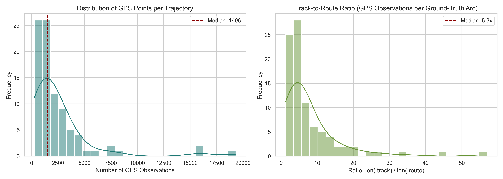

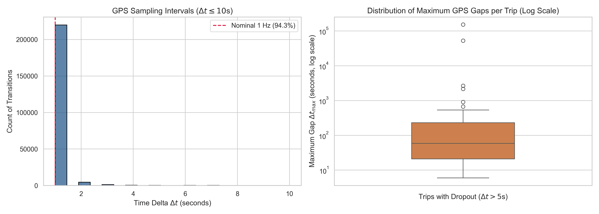

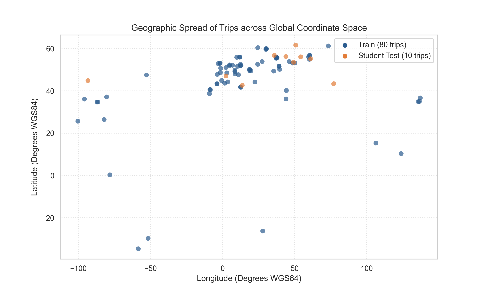

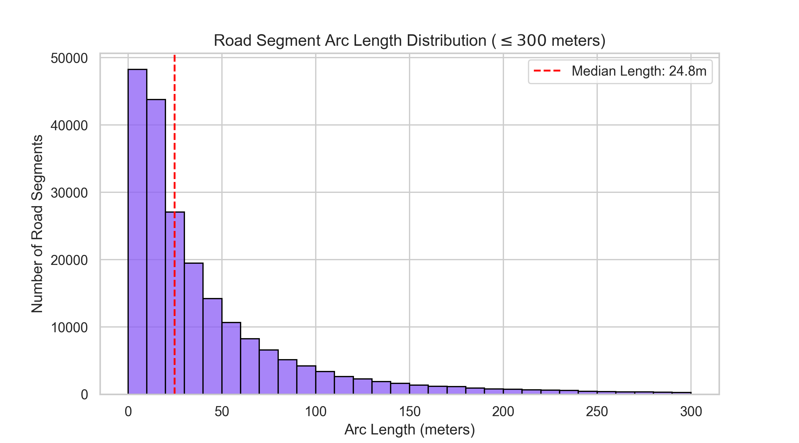

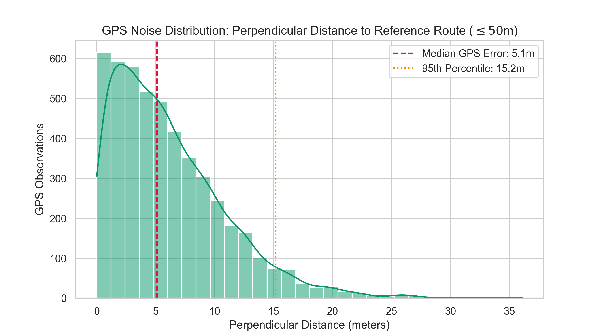

An interactive Folium map of a training trip (GPS points, road network, reference route) is in `person2/eda/outputs/folium_train_00000003.html`.

# 3. Model experimentation and comparison

## 3.1 Overall model comparison

**How every model was measured.** All models use the same candidate table (Person 1, commit `86ad172`): 2,546,809 candidate rows from 80 training trips (208,417 GPS points) and 276,962 candidate rows from the 10 student-test trips (19,160 GPS points). Each candidate is a (GPS point, road arc) pair; the label is 1 for the single arc the GPS point is matched to on the reference route. Positives are 7.5% of training candidates. Cross-validation uses the trip-grouped 5-fold split shipped in the table (16 trips per fold, no trip in two folds), seed 42; validation folds and the student-test set are scored in full, with no resampling. All runs were trained and timed on one machine (16 logical CPUs).

**Features.** 13 per candidate: the 5 frozen features (`feat_dist_to_arc`, `feat_arc_length`, `feat_heading_diff`, `feat_speed`, `feat_time_gap`) plus 8 context features (`f2_proj_frac`, `f2_end_dist`, `f2_cos_heading`, `f2_ctx_dist`, `f2_dist_minus_min`, `f2_ctx_minus_min`, `f2_dist_rank`, `f2_n_cand`), computed by `person2/experiments/context_features.py` from the raw `.track` and `.nodes` files and the candidate list only (no labels, no reference route), so the API computes them live with the same function. The change from the 5 frozen features was agreed by the team and every model was re-run on the new table (see 3.1.1).

**Metric definitions.** *Macro F1* averages the F1 of class 0 and class 1 at threshold 0.5. *Top-1 accuracy*: for each GPS point take the candidate with the highest probability; it is correct if that candidate carries label 1 (ties go to the smaller arc id). *Candidate miss rate*: share of GPS points whose reference arc is not among the candidates, which caps Top-1. *Log loss* penalises confident wrong probabilities. *ECE* is the average gap between predicted probability and observed frequency over 10 bins. *Route continuity (classifier-only)*: share of consecutive top picks that are connected in the road network, from `evaluation/route_metrics.py` (Person 3), before any HMM decoding.

| Model | Algorithm family | Key configuration | CV macro F1 (mean ± std) | CV Top-1 | Test Top-1 | Route continuity (classifier-only, test) | Test log loss | Test macro F1 | Inference time |
|---|---|---|---|---|---|---|---|---|---|
| xgboost | Boosting (gradient-boosted decision trees) | colsample_bytree=0.8, gamma=0, learning_rate=0.1, max_depth=6, min_child_weight=1, n_estimators=300, reg_lambda=1, subsample=0.8 | 0.9071 ± 0.0334 | 0.7640 | 0.8466 | 0.9340 | 0.0571 | 0.9227 | 16.6 ms per trip |
| gaussian_nb | Probabilistic (generative, Naive Bayes) | var_smoothing=1e-09 | 0.6989 ± 0.0205 | 0.6882 | 0.7443 | 0.8949 | 0.7344 | 0.6923 | 5.0 ms per trip |
| logistic_regression | Linear (logistic regression) | class_weight=balanced, max_iter=1000 | 0.7225 ± 0.0421 | 0.7256 | 0.8093 | 0.9151 | 0.2311 | 0.7452 | 2.6 ms per trip |
| random_forest | Tree ensemble (bagging) | class_weight=balanced_subsample, max_depth=12, n_estimators=100 | 0.8678 ± 0.0379 | 0.7647 | 0.8444 | 0.9326 | 0.1020 | 0.8844 | 22.3 ms per trip |
| hist_gradient_boosting | Boosting (histogram gradient boosting) | class_weight=balanced, learning_rate=0.05, max_iter=150 | 0.8513 ± 0.0616 | 0.7641 | 0.8449 | 0.9287 | 0.1079 | 0.8797 | 36.3 ms per trip |
| linear_svm | Kernel-based (linear SVM) | C=1, class_weight=balanced, max_iter=5000 | 0.6965 ± 0.0503 | 0.7309 | 0.8176 | 0.9132 | 0.3586 | 0.7202 | 2.3 ms per trip |

Reference point: predicting the base rate for every candidate gives a student-test log loss of 0.2469. Inference time is the median of 5 repeated `predict_proba` calls on the complete student-test candidate set after a warm-up, all models timed one after another on an otherwise idle machine (`person2/experiments/time_models.py`).

**Reading the table.**

- XGBoost is best on every probability and classification measure (student-test log loss 0.0571, macro F1 0.9227, CV macro F1 0.9071).
- Random forest and HGB are close behind on Top-1 (0.8444 and 0.8449 against 0.8466) but have about twice the log loss (0.1020, 0.1079). They are trained with `class_weight="balanced"`, which pushes positive probabilities up; XGBoost is trained without class weights and is the best calibrated (ECE 0.004 against 0.043 and 0.043).
- Gaussian NB has the worst log loss (0.7344, worse than the base rate 0.2469): several context features are very skewed (skew of `f2_end_dist` 17, `feat_time_gap` 260), which breaks its bell-curve assumption.
- XGBoost's CV Top-1 is lowest on fold 0 (0.491), the fold with the highest candidate miss rate (26.3%); among points whose reference arc is a candidate it ranges from 0.666 to 0.918. The student-test trips have a lower miss rate (2.5%).

### 3.1.1 Why the feature set changed (evidence)

With the 5 frozen features, the tuned XGBoost picked a wrong arc for 24.9% of student-test GPS points (classifier only). Of those wrong picks, 48.1% were an *adjacent* arc (sharing a node with the true arc: the point is near a junction), 29.7% were the *reverse-direction twin* of the true arc, and 22.2% were other arcs. The frozen features carry no information about where along an arc a point projects, use a one-step heading, and score each candidate without looking at the other candidates or at the neighbouring GPS points. With the frozen features the HMM decoder gained nothing from the classifier: on the student-test trips it scored the same with classifier emissions as with distance alone (section 5). The context features target exactly these cases. With them, XGBoost's wrong picks fall to 12.8% (25.9% adjacent, 45.0% reverse, 29.1% other).

| Model | Test Top-1, 5 frozen features | Test Top-1, with context features | Test log loss, 5 frozen | Test log loss, with context |
|---|---|---|---|---|
| xgboost | 0.7216 | 0.8466 | 0.1085 | 0.0571 |
| gaussian_nb | 0.5185 | 0.7443 | 0.4293 | 0.7344 |
| logistic_regression | 0.6603 | 0.8093 | 0.4299 | 0.2311 |
| random_forest | 0.7224 | 0.8444 | 0.2257 | 0.1020 |
| hist_gradient_boosting | 0.7246 | 0.8449 | 0.2359 | 0.1079 |
| linear_svm | 0.6404 | 0.8176 | 0.5560 | 0.3586 |

The 5-feature runs stay in `person2/experiments/logs/` and their tables and figures in `person2/experiments/results/v1_frozen_features/`.

**Primary selection metric.** We select on cross-validated log loss, with Top-1 as tie-break. The HMM decoder uses these probabilities as emission scores, so probability quality is what it needs; macro F1 depends on a fixed 0.5 threshold that is arbitrary when each GPS point has about 12 candidates and one positive (calibrated Gaussian NB, for example, changes log loss from 0.7344 to 0.1208 while its macro F1 moves from 0.6923 to 0.8084). On this basis XGBoost is the selected model.

### Probability calibration check

| Run | CV log loss (pooled) | Test log loss | Test ECE | Test macro F1 | Test Top-1 |
|---|---|---|---|---|---|
| XGBoost | 0.0867 | 0.0571 | 0.0044 | 0.9227 | 0.8466 |
| XGBoost + isotonic | 0.0792 | 0.0555 | 0.0048 | 0.9230 | 0.8468 |
| Gaussian NB | 0.7568 | 0.7344 | 0.1360 | 0.6923 | 0.7443 |
| Gaussian NB + isotonic | 0.1445 | 0.1208 | 0.0092 | 0.8084 | 0.7269 |

Isotonic calibration (fitted on out-of-fold scores, trip-grouped) changes XGBoost's log loss only from 0.0571 to 0.0555, so the final model is uncalibrated XGBoost. It repairs Gaussian NB's probabilities (0.7344 to 0.1208).

**Provenance.** XGBoost and Gaussian NB are Person 2's. Logistic regression, random forest and HGB use the hyperparameters from the teammates' scripts (`experiments/train_model*.py`); the linear SVM is Person 3's (`person2/experiments/models.py`). All were run through the same harness on the same table. KNN and the MLP were not re-run on the context-feature table.

## 3.2 Model subsections

### XGBoost (gradient-boosted decision trees)

**A. Model understanding**

1. *Why suitable.* Each candidate is described by 13 numeric clues whose effect interacts (how far a candidate may be from the GPS point depends on where along the arc it projects, on the heading agreement and on the neighbouring points). Boosted trees learn such interactions, need no scaling, and are insensitive to heavy tails (`feat_time_gap` reaches 153,064 s). The data support a non-linear model: on the same features XGBoost reaches log loss 0.0571 and macro F1 0.9227, logistic regression 0.2311 and 0.7452. With the logistic objective it outputs probabilities the HMM uses directly.
2. *Strengths and limitations.* Strengths: best log loss, best macro F1, best calibration (ECE 0.004), fit in 22 s on 2.5 million rows. Limitations: it scores each candidate alone, so it cannot guarantee a connected route (classifier-only Top-1 0.8466); at threshold 0.5 it finds 85.6% of true matches (precision 85.6%), so the route comes from ranking plus the HMM.

**B. Training and configuration**

5. *Important hyperparameters (initial values).* n_estimators = 300, max_depth = 6, learning_rate = 0.1, subsample = 0.8, colsample_bytree = 0.8, min_child_weight = 1, reg_lambda = 1.0, gamma = 0.0; histogram tree method, seed 42, no class weights. Tuned values: section 4.
6. *Objective.* Binary logistic loss (log loss), minimised by gradient boosting with L2 leaf regularisation (reg_lambda) and a split penalty (gamma).

**C. Experimental results**

7–8. *Student-test results (10 trips).* Top-1 0.8466 (0.8686 among points whose reference arc is a candidate), macro F1 0.9227 (macro precision 0.9229, macro recall 0.9226), log loss 0.0571, AUC 0.9840. Confusion matrix at 0.5: TN 255,607, FP 2,681, FN 2,698, TP 15,976. Cross-validation: macro F1 0.9071 ± 0.0334, log loss 0.0866.
9. *Overfitting or underfitting?* The loss curve (`xgboost_learning_curve.png`) shows the mean validation log loss lowest at round 34 (0.0755), ending at 0.0866 after 300 rounds while training loss falls to 0.0372 (final gap 0.0494). Validation loss rises 15% after its best round, which is clear overfitting in the number of rounds; the tuned settings (lower learning rate, more regularisation) remove most of it (section 4). Generalisation to unseen trips is sound: CV macro F1 0.9071, student-test 0.9227.

### Gaussian Naive Bayes

**A. Model understanding**

1. *Why suitable.* The simplest probabilistic classifier: one bell curve per feature and class, combined with Bayes' rule, fitted in closed form in under a second. It is the baseline that shows how much the flexible models gain.
2. *Strengths and limitations.* Strength: speed (0.8 s to train). Limitations on this data: the bell-curve assumption is badly wrong (skew 8.2 for `feat_dist_to_arc`, 17 for `f2_end_dist`, 260 for `feat_time_gap`), and the context features are strongly related to each other by construction (e.g. `f2_dist_minus_min` is derived from `feat_dist_to_arc`), so independence does not hold. Its raw log loss (0.7344) is worse than the base rate.

**B. Training and configuration**

5. *Hyperparameters.* `var_smoothing` = 1e-09; class priors from the data. Features are standardised, which does not change a Gaussian NB except through the floor.
6. *Objective.* Maximum likelihood under the Gaussian-independence model, solved in closed form; no iterative loss.

**C. Experimental results**

7–8. *Student-test results.* Top-1 0.7443, macro F1 0.6923, log loss 0.7344, AUC 0.9530. CV macro F1 0.6989 ± 0.0205. With isotonic calibration: log loss 0.1208, macro F1 0.8084, Top-1 0.7269.
9. *Overfitting or underfitting?* Underfitting: in-sample macro F1 0.6961 is close to the CV value 0.6989, so the model is too rigid rather than memorising. It has no epoch-wise history, so no training curve is drawn.

### Random Forest (run `20261118-173230_random_forest`)
**A1. Why suitable.** The useful signal is non-linear and interacting: a small distance matters only when the heading agrees, and where along the arc the point projects changes what "close" means. Bagged trees capture these interactions without any feature scaling.

**A2. Strengths and limitations.**
- **Strengths:** high positive recall (0.951) and a Top-1 within 0.3 points of XGBoost (0.8444 against 0.8466); classifier-only route continuity 0.9326.
- **Limitations:** less well calibrated probabilities. `class_weight="balanced_subsample"` inflates positive scores, giving a student-test ECE of 0.043 against 0.004 for XGBoost and a log loss of 0.1020 against 0.0571. That is why its probabilities were not used as HMM emissions. It is also the slowest to train (113 s) and scores in 22.3 ms per trip.

**B5. Hyperparameters.** n_estimators = 100, max_depth = 12, class_weight = balanced_subsample.

**B6. Objective.** Each tree greedily minimises Gini impurity at its splits, and the forest averages the trees' votes.

**C7/C8. Student-test results.**
- Top-1: 0.8444
- Macro F1: 0.8844
- Log loss: 0.1020

**C9. Over- or underfitting?** CV macro F1 (0.8678 ± 0.0379) and student-test macro F1 (0.8844) agree, so there is no sign of overfitting at depth 12.

### Linear SVM (runs `20261118-174412_linear_svm` and `20261118-184834_linear_svm_platt`)
**A1. Why suitable.** It is a fast, maximum-margin linear baseline from a different family (kernel-based). It tests how much of the problem a single weighted combination of the features can solve.

**A2. Strengths and limitations.**
- **Strengths:** among the fastest models (2.3 ms per trip) and it does not overfit.
- **Limitations:**
  - It cannot represent interactions between features, so it underfits: student-test Top-1 0.8176 against 0.8466 for XGBoost.
  - Its output is a margin, not a probability. Raw scores give log loss 0.3586 and ECE 0.239. Trip-grouped Platt calibration (`--calibrate sigmoid`) brings these to 0.1018 and 0.024 without changing the ranking (Top-1 is unchanged).
  - Classifier-only route continuity is 0.9132 (arc-change 0.6944).

**B5. Hyperparameters.** C = 1.0, class_weight = balanced, max_iter = 5,000. Features are standardised inside the pipeline.

**B6. Objective.** L2-regularised squared hinge loss (LinearSVC). The Platt step then fits a logistic regression on the out-of-fold margins.

**C7/C8. Student-test results.**

| Version | Top-1 | Macro F1 | Log loss |
|---|---|---|---|
| Raw | 0.8176 | 0.7202 | 0.3586 |
| Platt-calibrated | 0.8176 | 0.8514 | 0.1018 |

**C9. Over- or underfitting?** It underfits. In-sample macro F1 is 0.6976 against CV 0.6965, a gap of only 0.001, and both are well below the tree models. The model is too simple for the problem, not memorising it.

### Logistic regression (run `20261118-173204_logistic_regression`)

**A. Model understanding.** 1. *Why suitable:* a linear model on standardised features is the simplest discriminative baseline and shows how much of the problem a weighted sum of the clues explains. 2. *Strengths and limitations:* very fast (4.1 s to train, 2.6 ms per trip) and a good ranker (AUC 0.9712), but it cannot model interactions, and `class_weight="balanced"` inflates positive probabilities (positive precision 0.388 at recall 0.936; ECE 0.124).

**B. Training and configuration.** 5. *Hyperparameters:* L2 penalty with C = 1, class_weight = balanced, max_iter = 1000, standard scaling inside the pipeline. 6. *Objective:* weighted binary cross-entropy (log loss) with an L2 penalty, minimised by L-BFGS.

**C. Experimental results.** 7–8. *Student-test:* Top-1 0.8093, macro F1 0.7452, log loss 0.2311. CV macro F1 0.7225 ± 0.0421. 9. *Over- or underfitting:* underfitting; CV and student-test macro F1 agree (0.7225 and 0.7452) and both are far below the tree models. No epoch-wise history, so no training curve.

### Histogram gradient boosting (run `20261118-174235_hist_gradient_boosting`)

**A. Model understanding.** 1. *Why suitable:* a second boosting implementation with histogram-binned splits, which is fast on millions of rows and checks whether XGBoost's advantage is about the algorithm family or the implementation. 2. *Strengths and limitations:* Top-1 0.8449, close to XGBoost, and fast to train (17 s), but `class_weight="balanced"` worsens its probabilities (log loss 0.1079, ECE 0.043) and it is the slowest to score (36.3 ms per trip).

**B. Training and configuration.** 5. *Hyperparameters:* learning_rate = 0.05, max_iter = 150, class_weight = balanced. 6. *Objective:* binary log loss, minimised by gradient boosting on histogram-binned features.

**C. Experimental results.** 7–8. *Student-test:* Top-1 0.8449, macro F1 0.8797, log loss 0.1079. CV macro F1 0.8513 ± 0.0616. 9. *Over- or underfitting:* no sign of overfitting; CV and student-test macro F1 agree (0.8513 and 0.8797).

### Other models tried

Distance-weighted KNN (k = 15) and a shallow MLP (64-32, ReLU, early stopping) were trained by Person 1 on the 5 frozen features with a different protocol (training on a stratified 100,000-150,000-row sample). Their results are in `docs/report/SECTION_2_EDA.md` and `experiments/results/model2_knn_results.json` / `model5_mlp_results.json`. They were not re-run on the final 13-feature table, so they are not part of the comparison above.

## 3.3 Visualisations

All figures are in `person2/experiments/results/`, drawn from the logged runs only (5-feature versions in `results/v1_frozen_features/`).

- `cv_macro_f1.png`: CV macro F1 per model (bar = mean, whisker = std, dots = folds).
- `student_test_top1_macro_f1.png`: Student-test Top-1 accuracy and macro F1 per model.
- `log_loss.png`: CV and student-test log loss per model.
- `confusion_matrices.png`: Student-test confusion matrices at threshold 0.5.
- `reliability.png`: Calibration curves on the student-test trips.
- `xgboost_learning_curve.png`: XGBoost train vs validation log loss per boosting round (the only model with an epoch-wise history).
- `xgboost_learning_curve_tuned.png`: The same curve for the tuned XGBoost.
- `with_calibration/reliability.png`: Calibration curves including the isotonic variants.

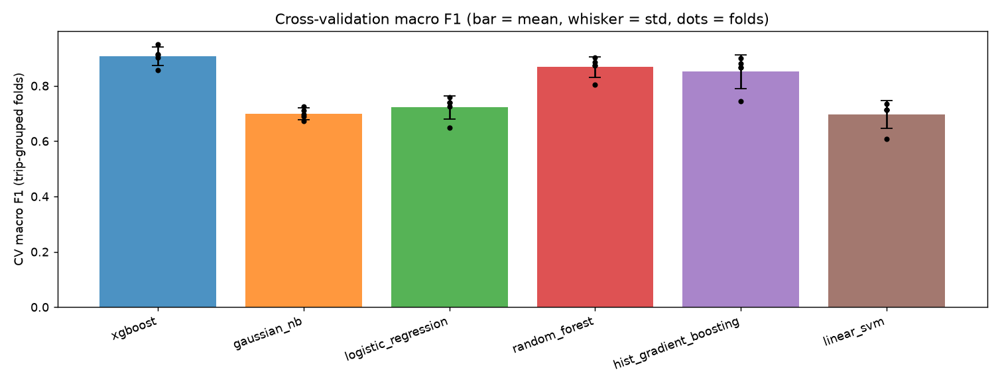

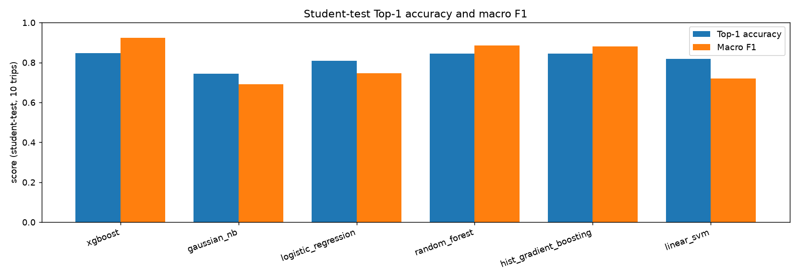

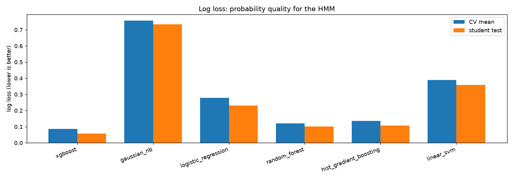

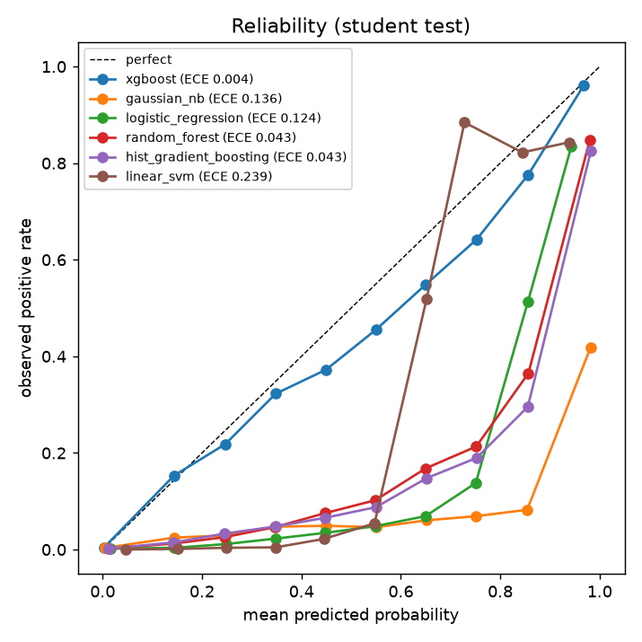

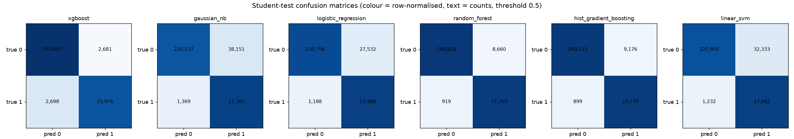

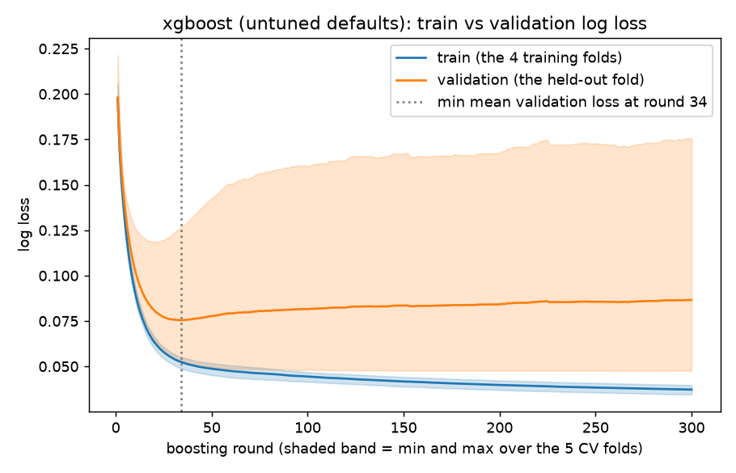

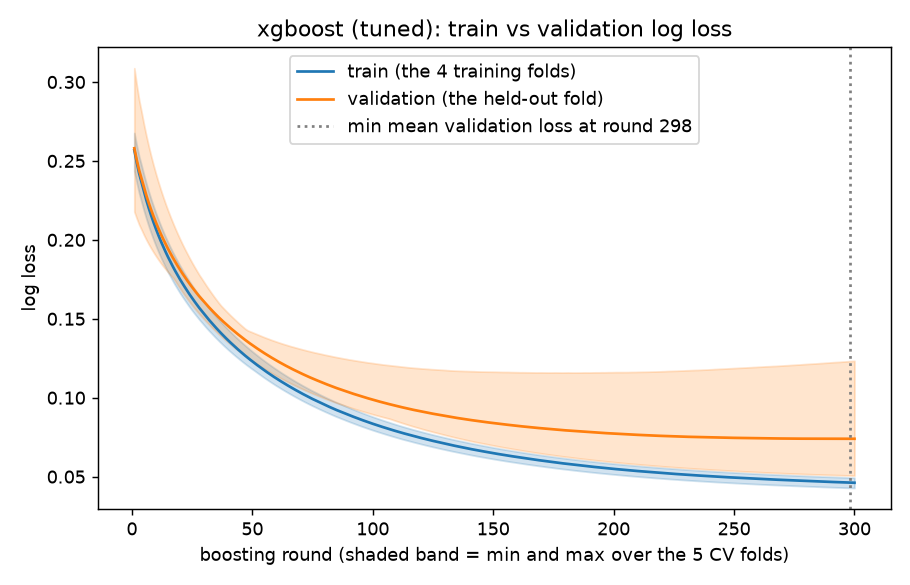

# 4. Bayesian hyperparameter optimisation

Model: XGBoost.

1. *Hyperparameters searched:* n_estimators, max_depth, learning_rate, subsample, colsample_bytree, min_child_weight, reg_lambda, gamma.
2. *Ranges and distributions* (fixed before tuning; reasons in `person2/tuning/search_space.json`):

| Hyperparameter | Type | Range | Scale |
|---|---|---|---|
| n_estimators | int | 100 to 500 step 50 | linear |
| max_depth | int | 3 to 10 | linear |
| learning_rate | float | 0.01 to 0.3 | log |
| subsample | float | 0.5 to 1.0 | linear |
| colsample_bytree | float | 0.5 to 1.0 | linear |
| min_child_weight | float | 1.0 to 20.0 | log |
| reg_lambda | float | 0.01 to 50.0 | log |
| gamma | float | 0.0 to 5.0 | linear |

3. *Objective:* mean over the 5 trip-grouped folds of the validation log loss (minimised), on the 80 training trips only. Why: Probability quality, which is what the HMM emission model uses. Chosen as the default objective after the baseline runs showed that macro F1 at a fixed 0.5 threshold is misleading here: each GPS point has ~12 candidates and exactly one positive (candidate positive rate ~7%), and a calibrated Gaussian NB predicted no positives at all (macro F1 0.48) although its log loss improved and its ranking (AUC) was unchanged. Decided before any tuning run, using training-partition CV and student-test baselines only.
4. *Trials:* 15 requested, 12 completed and 3 stopped early by the median pruner; Bayesian optimisation: Tree-structured Parzen Estimator (optuna.samplers.TPESampler), first 5 trials random; 25 minutes in total.
5. *Best values* (trial 6, CV log loss 0.0740): n_estimators = 300, max_depth = 9, learning_rate = 0.01118, subsample = 0.6628, colsample_bytree = 0.9547, min_child_weight = 4.152, reg_lambda = 0.1175, gamma = 3.451.
6. *Tuned vs untuned* (same table, folds, seed and metrics):

| Metric | Untuned (defaults) | Tuned | Difference |
|---|---|---|---|
| CV log loss (the objective) | 0.0866 | 0.0740 | -0.0126 |
| CV macro F1 | 0.9071 | 0.9085 | +0.0014 |
| Student-test Top-1 | 0.8466 | 0.8472 | +0.0006 |
| Student-test macro F1 | 0.9227 | 0.9236 | +0.0009 |
| Student-test log loss | 0.0571 | 0.0549 | -0.0022 |
| Inference time (ms per trip) | 16.6 | 26.2 | +9.5 |
| Training time (s) | 22.2 | 28.9 | +6.8 |

The tuned model is better on the optimised quantity: CV log loss 0.0866 to 0.0740 (-14.6%). On the student-test trips: log loss -0.0022, Top-1 +0.0006, macro F1 +0.0009 (10 trips: differences of a few thousandths are within noise). The final model uses the tuned settings, chosen on the CV objective only. Loss curves: default best validation round 34 of 300 (gap 0.049); tuned best round 298 of 300 (gap 0.028).

An earlier study on the 5 frozen features is kept in `person2/tuning/studies/xgboost_cv_log_loss/` for the record. Figures: `person2/tuning/studies/xgboost_v2_cv_log_loss/optimization_history.png`, `param_importance.png`; full trial log `trials.csv`.

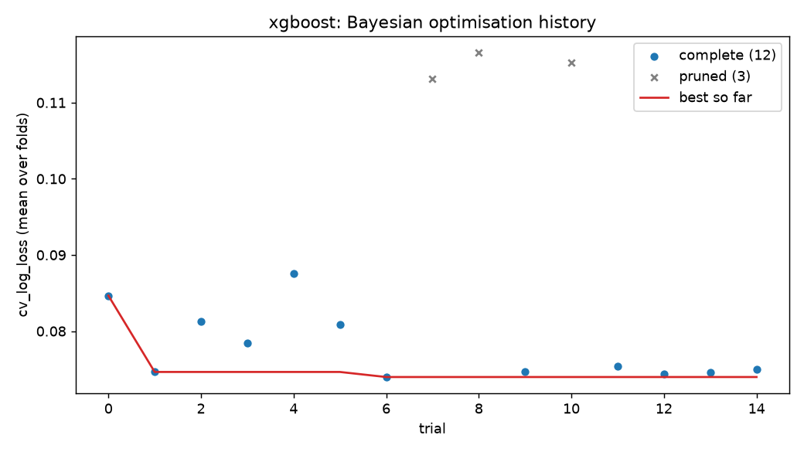

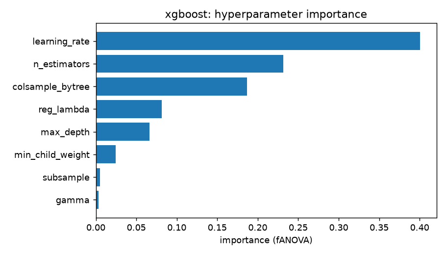

# 5. HMM and Viterbi route reconstruction

## 5.1 Hidden states
At GPS observation *t*, the hidden states are that observation's candidate arcs: the rows of the frozen candidate table, all arcs within 60 m. Each state carries its own `arc_id`, so the candidate-to-road-segment mapping is preserved. The decoder returns exactly one `arc_id` per GPS observation (`hmm/decoder.py`).

## 5.2 Emission probabilities
For candidate arc *a* at observation *t*:

  log e_t(a) = w · log p_t(a) + (1 − w) · ( −½ (d_t(a) / σ)² )

- *p_t(a)* is the probability from the selected classifier (tuned XGBoost on the 13 features of Section 3.1, student-test ECE 0.005). For the training trips it is the out-of-fold probability, so no trip is scored by a model that saw it.
- *d_t(a)* is the perpendicular distance in metres from the GPS point to the arc.
- σ = 5.5 m is the GPS-noise scale (tuned). Person 1 measured a median GPS-to-road error of 4.7 m.
- w = 0.35 is the classifier weight (tuned).

## 5.3 Transition probabilities (Newson & Krumm formulation)
From arc *a* at *t−1* to arc *b* at *t*:

- route(a, b) = o_b − o_a if *a* = *b* and the point moved forward (or back by less than 25 m of GPS jitter).
- Otherwise, route(a, b) = (L_a − o_a) + sp(end(a), start(b)) + o_b.
- log T(a, b) = −| route(a, b) − gc(t−1, t) | / β, with β = 10 m.

Here *o* is the position of the GPS projection along the arc, *L* is the arc length, *sp* is the directed shortest road path (SciPy Dijkstra, cut off at 1,000 m), and *gc* is the straight-line distance between the two GPS points.

A real drive covers about as much road as the GPS moved, so the cost is close to 0. A jump to a parallel or unconnected street needs a long detour, so the cost is large. Arcs are directed: the opposite-direction twin of a two-way street only fits by "going round the block".

## 5.4 Viterbi recurrence (log space)
- V₀(s) = log e₀(s)
- V_t(s) = log e_t(s) + max_{s'} [V_{t−1}(s') + log T(s', s)]

The best path is found by backtracking the stored argmax pointers. Log space turns products of many small probabilities into sums, so they do not underflow.

## 5.5 Missing candidates and GPS gaps
- An observation with no candidates splits the sequence and is returned as −1. This never happened: every observation had at least one candidate.
- A time gap above 30 s (tuned; values tried: 10 s and 30 s) splits the trip into independent segments, because after a long dropout the car could be anywhere.
- Each segment is decoded separately.

## 5.6 Disconnected consecutive observations
If arc *b* cannot be reached from *a* within 1,000 m of road (one-way conflict, a different component, or an implausible detour), the transition gets a fixed log-probability of −25 (tuned; values tried: 10, 25, 50) instead of −∞. The decoder can therefore still recover when the candidate set is wrong.

Connectivity EDA (`docs/eda/road_network_connectivity.md`) showed that 89 of 90 road networks are fragmented, but no reference route crosses fragments, so a finite penalty is enough.

## 5.7 Tuning
- **Method:** a coarse grid over w × σ × β (36 combinations: w ∈ {0.25, 0.5, 0.75, 1.0}, σ ∈ {7, 10, 15} m, β ∈ {10, 20, 50} m; `hmm/tuning/grid_search_coarse.csv`). Its best values lay on the edges of the grid, so a refined grid followed (27 combinations: w ∈ {0.15, 0.25, 0.35}, σ ∈ {4, 5.5, 7} m, β ∈ {5, 7.5, 10} m), then the unreachable-transition penalty, then gap × backtrack tolerance (`hmm/tuning/grid_search.csv`).
- **Objective:** pooled pointwise accuracy on the 80 training trips, using out-of-fold probabilities.
- **Chosen:** w = 0.35, σ = 5.5 m, β = 10 m, penalty 25, gap 30 s, backtrack tolerance 25 m (`hmm/tuning/best_params.json`, written to `hmm/config.yaml`).
- **Probabilities:** Person 2's logged run `20261118-181912_xgboost_tuned` (the deployed model).
- **Speed:** decoding takes 0.18 s per student-test trip (0.15 s prepare + 0.04 s Viterbi).

## 5.8 Did the HMM improve the route? (student-test, 10 trips, 19,160 observations)

| Method | Pointwise acc. | Route continuity | Arc-change continuity | Sequence score |
|---|---|---|---|---|
| Classifier only (argmax per point) | 0.8472 | 0.9336 | 0.7539 | 0.7735 |
| **Classifier + HMM (deployed)** | **0.8728** | **0.9743** | **0.8640** | **0.8633** |
| HMM, distance-only emissions (reference) | 0.8599 | 0.9724 | 0.8574 | 0.8425 |

On the training trips (out-of-fold probabilities), the same three rows give 0.7727, 0.7984 and 0.7884 pointwise accuracy.

- **Pointwise accuracy:** the share of GPS points matched to the reference arc. Each point's reference arc is assigned exactly as the training labels were (`match_gps_to_route_arcs`).
- **Route continuity:** the share of consecutive predictions (u, v) with u = v or end(u) = start(v).
- **Arc-change continuity:** the same, counted only where the arc changes. At 1 Hz most pairs stay on the same arc, which flatters plain continuity.
- **Sequence score:** the difflib similarity of the predicted and reference routes, each written as an ordered list of distinct arcs.

**Where it helped.** The HMM raised pointwise accuracy on 7 of the 10 trips (by up to 8.4 points) and corrected 995 observations the classifier got wrong. Its clearest gain is continuity at arc changes, from 0.754 to 0.864: the classifier alone occasionally jumps to a neighbouring or parallel arc for a single point, and the transition model removes those jumps. Stops are a typical case: a stationary car's GPS drifts, and the classifier alone can move to the parallel road (Section 6 map).

**Where it did not help.**
- **New errors.** The HMM broke 505 points the classifier had right, about 1 for every 2 it fixed. Only 5 of them were within 3 points of a segment start, so most are short stretches where the decoder held on to a plausible but wrong arc. On 3 trips this cost slightly more than it gained (at most −1.3 points).
- **Errors neither method could fix.** 1,933 points stay wrong with or without the HMM. For 486 of them the true arc was not in the candidate set at all, so no decoder could fix them.
- **Classifier vs geometry.** The classifier adds information beyond distance: with it the HMM scores 0.8728 against 0.8599 for distance-only emissions on the student-test trips (0.7984 against 0.7884 on the training trips), and it is better on 8 of the 10 test trips.

# 6. Geographical visualisation (Folium)

`maps/folium_generator.py` draws toggleable layers (Leaflet layer control) with a legend:

- raw GPS points (blue dots)
- road network within 150 m of the trace (grey)
- reference route (green)
- classifier-only route (orange, report maps only)
- predicted HMM route (red, dashed)

The view is fitted to the GPS trace. Only nearby roads are drawn, because a trip's road file covers the whole region: 165,000 arcs for the largest trip.

The map the API returns to the UI never contains the reference route; this is checked in `tests/test_api.py`.

Figures were generated by `maps/export_report_maps.py` for student-test trip 00000077, the trip where the HMM changed the most points (classifier-only 0.6778 → HMM 0.7614, 475 observations corrected):

- `docs/figures/person3_trip_00000077_full.png`: the whole trip.
- `docs/figures/person3_trip_00000077_zoom.png`: observations 3758–3847, where the HMM corrected 43 of 90 points. The car is stopped and its GPS points form a cloud between two parallel roads. The classifier alone (orange) puts them on the main road, while the HMM (red) stays on the reference route (green).

The interactive HTML files are written to `maps/html/`, which is git-ignored; regenerate them with the same script.

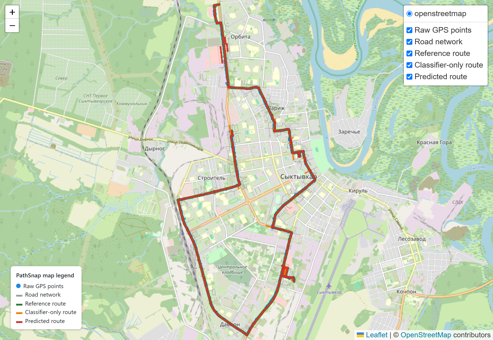


# 7. API, UI and deployment

## 7.1 Architecture

- **Laptop 1 (model server):** FastAPI (`api/main.py`) on port 8000 with `GET /health`, `GET /trips` (lists the 10 evaluator trips when they are installed) and `POST /predict/{trip_id}`. A prediction runs the full pipeline in `api/pipeline.py`: load the trip, generate candidates and the 13 features, score them with `person2/models/final/model.joblib`, decode with the tuned Viterbi decoder (`hmm/config.yaml`) and score the result against the reference route on the server.
- **Laptop 2 (evaluator UI):** Streamlit (`ui/app.py`) on port 8501. The API address is configurable in the sidebar; the UI lists the trips, sends the chosen trip ID and shows accuracy, continuity, latency and the route map.
- **Deployment:** `deploy/run_laptop1_api.bat|.sh` and `deploy/run_laptop2_ui.bat|.sh`; the API binds to all interfaces, CORS is enabled, and both laptops share a network (a phone hotspot as fallback; see `deploy/README.md`).

## 7.2 Ground truth isolation and logging

Reference routes stay on Laptop 1. The response contains the predicted arcs, the accuracy figures and timing; the map sent to the UI never contains the reference route (`tests/test_api.py`). Predictions are computed for every request; nothing is hard-coded. Every request is logged with trip ID, time, client, latency, accuracy and execution mode (`api/logs/requests.log`).

## 7.3 Results of the full pipeline

| Partition | Trips | Pooled accuracy | Mean trip accuracy | Trip accuracy range | Mean route continuity | Mean server latency |
|---|---|---|---|---|---|---|
| Student-test | 10 | 0.8728 | 0.8914 | 0.761–0.991 | 0.9706 | 477 ms |
| Evaluator | 10 | 0.8716 | 0.8923 | 0.787–0.958 | 0.9448 | 494 ms |

All 20 trips ran in `model_plus_viterbi` mode (the trained model and the decoder). Source: `person2/experiments/evaluate_pipeline.py`, which calls the same `api/pipeline.py` as the server.

## 7.4 UI screenshots

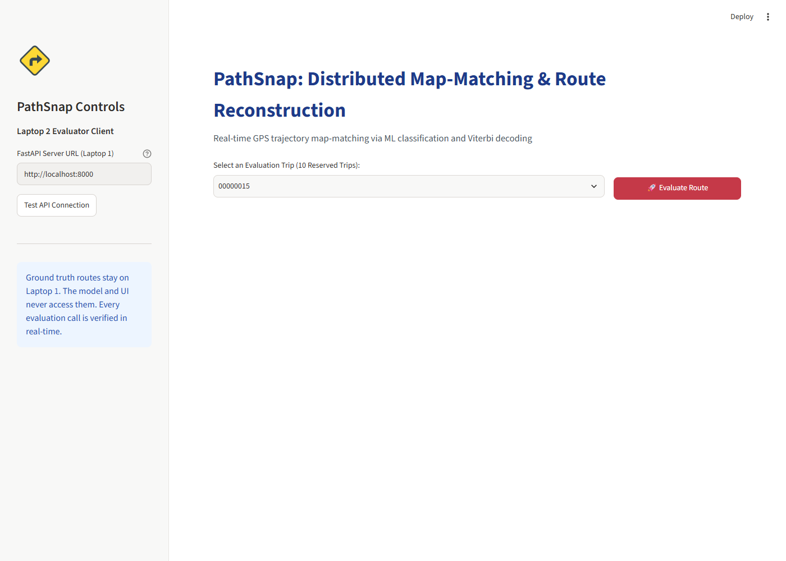

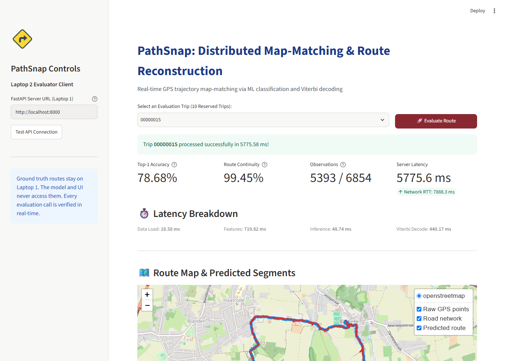

## 7.5 API request log (Laptop 1)

Last entries of `api/logs/requests.log` from the run shown above:

```
[2026-11-18 19:13:18] [INFO] [PathSnap] EVALUATOR_REQ | Trip: 00000000 | Client: testclient | Mode: model_plus_viterbi | Latency: 2719.51ms | Top-1 Acc: 90.53% | Continuity: 98.36%
[2026-11-18 19:13:20] [INFO] [PathSnap] EVALUATOR_REQ | Trip: 00000007 | Client: testclient | Mode: model_plus_viterbi | Latency: 1728.32ms | Top-1 Acc: 99.11% | Continuity: 99.93%
[2026-11-18 19:13:20] [WARNING] [PathSnap] Trip not found: 99999999 from testclient
[2026-11-18 19:13:23] [INFO] [PathSnap] EVALUATOR_REQ | Trip: 00000009 | Client: testclient | Mode: model_plus_viterbi | Latency: 2431.36ms | Top-1 Acc: 92.09% | Continuity: 95.04%
```

# 8. Academic integrity and AI assistance

- The evaluator trips were not used for training, feature design, tuning, thresholds or model choice; they were scored once with the final pipeline. Reference labels never reach the model inputs or the UI.
- Every reported number is produced by a script in the repository from a logged run (seeds, parameters, library versions and the feature-table hash are recorded per run).
- AI assistants were used during development: for repository scaffolding and API/UI boilerplate (`docs/report/AI_ASSISTANCE_DISCLOSURE.md`), and, for the Person 2 track, an AI coding assistant (Claude Code) helped write the evaluation harness, experiment scripts, report-generation scripts and draft report text. All experiments were run on the course data in this repository, and the team reviewed the code and results.
