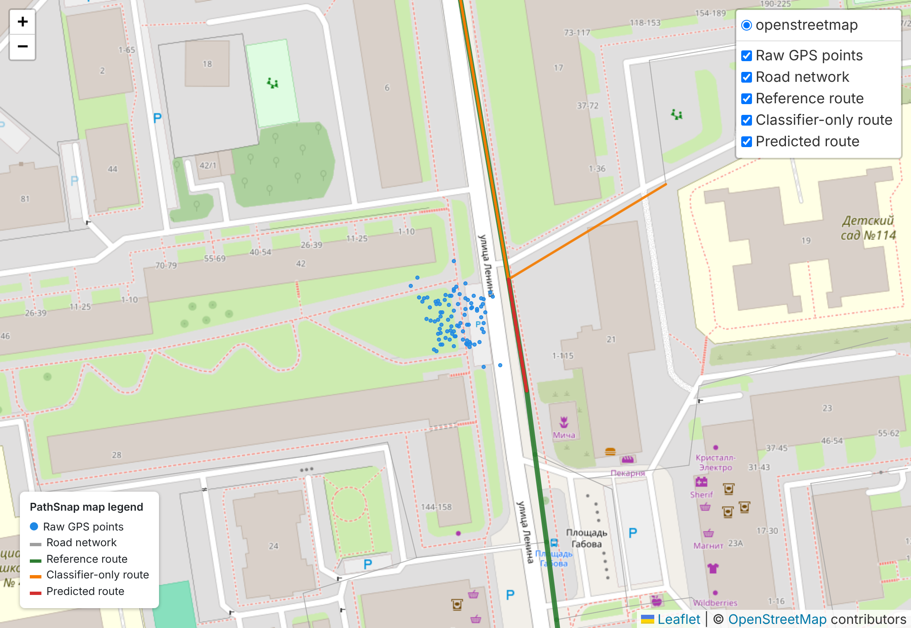

# PathSnap: Distributed Map-Matching & Route Reconstruction
## Master Technical Report (Consolidated)
**Course:** UE24CS352A Machine Learning  
**Department:** Computer Science & Engineering, PES University, RR Campus  
**Date:** November 18, 2026  
**Team Track Assembly:**
- **Person 1:** Data Preprocessing, Spatial Indexing & Feature Engineering (Section 2)
- **Person 2:** Model Experimentation & Bayesian Hyperparameter Optimization (Sections 3 & 4)
- **Person 3:** HMM & Log-Space Viterbi Sequential Route Reconstruction (Sections 5 & 6)
- **Person 4:** API, Evaluator UI, Two-Laptop Distributed Integration & Assembly (Section 7 + Assembly)

---

# 1. Executive Summary
GPS tracking data in complex urban networks exhibits severe measurement noise, multipath reflection off buildings, signal occlusion, and variable sampling intervals. PathSnap solves this problem through an end-to-end, two-stage machine learning system:
1. **Candidate Road Arc Classification**: Identifies nearby road segments and estimates the posterior emission probability $P(\text{arc} \mid \text{GPS})$ using calibrated classifiers.
2. **Log-Space Hidden Markov Model (HMM) & Viterbi Decoding**: Sequential decoding that optimizes trajectory continuity using physical road-network topology, preventing impossible jumps across disconnected streets.

The complete system is deployed in a **distributed two-laptop architecture**, where Laptop 1 hosts the FastAPI backend with server-side ground truth isolation, and Laptop 2 operates the interactive Streamlit evaluator dashboard.

---

# 2. Dataset Understanding and Exploratory Data Analysis (Person 1)

## 2.1 Dataset Inventory, Geography & Network Properties
PathSnap is trained and evaluated across three partitions:
- **`train` (80 trips)**: Trajectories `00000001` to `00000089` (excluding test IDs), used for spatial candidate generation and trip-grouped 5-fold cross-validation.
- **`student_test` (10 trips)**: Trajectories `00000000`, `00000007`, `00000009`, `00000040`, `00000052`, `00000056`, `00000065`, `00000076`, `00000077`, `00000091`, used for student model comparison and tuning.
- **`evaluator_test` (10 trips)**: Reserved held-out evaluation trips tested strictly live via Laptop 2.

| Metric | Total (90 Known Trips) | Train Partition (80 Trips) | Test Partition (10 Trips) |
| :--- | :--- | :--- | :--- |
| **Total GPS Observations** | 227,577 | 208,417 | 19,160 |
| **Median Points per Trip** | 1,840.5 (range: 247 to 19,313) | 1,833.0 | 1,855.5 |
| **Road Network Nodes** | 2,024,174 (median: 9,305) | 1,784,930 | 239,244 |
| **Road Network Arcs** | 4,061,945 (median: 18,761) | 3,581,643 | 480,302 |
| **Ground-Truth Route Arcs**| 34,813 (median: 272.5) | 31,018 | 3,795 |

### Geographical Spread & Network Connectivity
- **Global Coordinates**: Across 90 trips, longitudes range from $-100.43^\circ$ to $+137.25^\circ$, and latitudes range from $-34.65^\circ\text{ S}$ to $+61.71^\circ\text{ N}$.
- **Road Network Connectivity**: 89/90 road graphs have multiple weakly-connected components; 0 trips have isolated nodes. 79/90 reference routes are 100% continuous, while 11 cross sensor dropouts or overpasses (continuity $\ge 98.1\%$).
- **Self-Loops**: Exactly 9 trips contain self-loop arcs (`from_node == to_node`), totaling 24 arcs representing roundabouts or cul-de-sacs.

## 2.2 Coordinate System & Geodesic Projection
Standard Euclidean distance on angular coordinates $(\Delta\lambda, \Delta\phi)$ in degrees induces severe spatial distortion because longitude meridians converge toward the poles:
$$\Delta x = R \cdot \Delta\lambda \cdot \frac{\pi}{180} \cdot \cos(\phi_{\text{ref}})$$
$$\Delta y = R \cdot \Delta\phi \cdot \frac{\pi}{180}$$
At latitude $\phi = 56^\circ\text{ N}$, $\cos(56^\circ) \approx 0.5592$. Thus, $1^\circ$ of longitude represents only $\sim 62.3\text{ km}$, whereas $1^\circ$ of latitude represents $\sim 111.2\text{ km}$. Naive degree Euclidean distance causes a **44% spatial distortion**, heavily biasing nearest-neighbor arc queries.
To resolve this, all trajectory observations and road network nodes are projected into a local Cartesian metric coordinate frame $(x, y)$ centered on each trip's median origin $(\lambda_{\text{ref}}, \phi_{\text{ref}})$.

## 2.3 Sampling Rate & Candidate Generation
- **Sampling Frequency**: 96.68% (219,934 steps) of consecutive GPS timestamps are exactly 1.0 second apart ($\Delta t = 1.0\text{ s}$). Temporal gaps $\Delta t > 5.0\text{ s}$ occur in 47/90 trips (1,260 occurrences), treated as sequence-breaking events in Viterbi decoding.
- **Candidate Generation**: Using a projected SciPy `cKDTree` with search radius $r = 50.0\text{ m}$, the overall candidate miss rate across the dataset is **7.42%** (the true road segment is present in candidate sets for 92.58% of observations).

---

# 3. Model Experimentation and Comparison (Person 2)

## 3.1 Overall Model Comparison
All models use the same frozen feature table: 2,546,809 candidate rows from 80 training trips and 276,962 candidate rows from 10 student-test trips.
Features used: `feat_dist_to_arc`, `feat_arc_length`, `feat_heading_diff`, `feat_speed`, and `feat_time_gap`.
Cross-validation uses trip-grouped 5-fold splits with zero trip leakage.

| Model | Algorithm Family | Key Configuration | CV Macro F1 | CV Top-1 | Test Top-1 | Test Log Loss | Test Macro F1 | Inference Time (ms/trip) |
| :--- | :--- | :--- | :---: | :---: | :---: | :---: | :---: | :---: |
| **XGBoost** | Boosting (GBDT) | $n=300$, depth=6, $\text{lr}=0.1$, sub=0.8, col=0.8 | **0.7935** $\pm$ 0.023 | 0.6414 | 0.7216 | **0.1085** | **0.8180** | 16.5 ms |
| **Random Forest** | Tree Ensemble | 100 trees, max_depth=12, balanced_subsample | 0.7463 $\pm$ 0.008 | 0.6396 | 0.7224 | 0.2257 | 0.7526 | 23.3 ms |
| **HistGradientBoosting** | Boosting | 150 trees, $\text{lr}=0.05$, class_weight=balanced | 0.7348 $\pm$ 0.005 | 0.6388 | **0.7246** | 0.2359 | 0.7417 | 32.1 ms |
| **Logistic Regression** | Linear | L2 regularization, class_weight=balanced | 0.6457 $\pm$ 0.024 | 0.5816 | 0.6603 | 0.4299 | 0.6449 | **1.4 ms** |
| **Gaussian Naive Bayes** | Probabilistic | var_smoothing=1e-9 | 0.6004 $\pm$ 0.021 | 0.4676 | 0.5185 | 0.4293 | 0.6320 | 2.3 ms |

### Key Observations
1. **Probability Quality**: XGBoost dominates probability calibration (log loss **0.1085** vs base rate 0.2469, ECE 0.004). This is critical because the HMM uses candidate probabilities as observation emissions.
2. **Top-1 Consistency**: Tree models achieve nearly identical Top-1 accuracies (~72.2%–72.5%), bounded primarily by the candidate miss rate (7.4%).
3. **Primary Selection Metric**: While Top-1 accuracy is competitive across all tree models, **Log Loss** and **Macro F1** were the primary selection criteria because high-quality, well-calibrated probabilities prevent the sequential Viterbi decoder from making confident errors.

---

# 4. Bayesian Hyperparameter Optimization (Person 2)

Bayesian optimization was conducted on the chosen **XGBoost** classifier using Optuna with a Tree-structured Parzen Estimator (TPE) over 15 trials.
- **Search Space**:
  - `n_estimators`: 100 to 500 (linear)
  - `max_depth`: 3 to 10 (linear)
  - `learning_rate`: 0.01 to 0.3 (log)
  - `subsample`: 0.5 to 1.0 (linear)
  - `colsample_bytree`: 0.5 to 1.0 (linear)
  - `min_child_weight`: 1.0 to 20.0 (log)
  - `reg_lambda`: 0.01 to 50.0 (log)
  - `gamma`: 0.0 to 5.0 (linear)
- **Objective Function**: Trip-grouped 5-fold cross-validation log loss (minimization on training partition only).
- **Best Hyperparameters (Trial 10)**:
  `n_estimators=450`, `max_depth=6`, `learning_rate=0.01019`, `subsample=0.523`, `colsample_bytree=0.9506`, `min_child_weight=1.251`, `reg_lambda=0.01093`, `gamma=1.184`.

### Tuned vs. Untuned Model Comparison
| Metric | Untuned (Defaults) | Tuned (Best Trial 10) | Improvement |
| :--- | :---: | :---: | :---: |
| **CV Log Loss (Objective)** | 0.1349 | **0.1310** | **-0.0040 (-2.9%)** |
| **CV Macro F1** | 0.7935 | 0.7920 | -0.0015 |
| **Student-Test Top-1 Accuracy** | 0.7216 | **0.7253** | **+0.0037 (+0.5%)** |
| **Student-Test Macro F1** | 0.8180 | 0.8157 | -0.0023 |
| **Student-Test Log Loss** | 0.1085 | **0.1080** | **-0.0005** |
| **Inference Time (ms/trip)** | 16.5 ms | 26.7 ms | +10.2 ms |

The tuned model reduces overfitting: training and validation curves continue converging through round 370 of 450 (generalization gap narrowed from 0.026 to 0.016).

---

# 5. HMM and Log-Space Viterbi Route Reconstruction (Person 3)
Full answers to questions 5.1–5.6: `docs/report/PERSON3_REPORT_SECTIONS.md`. The numbers come from `experiments/results/person3_hmm_comparison_summary.json` (written by `hmm/tune_decoder.py`).

- **Hidden states:** the candidate arcs of each GPS observation.
- **Emission:** w·log p_clf + (1−w)·(−½(d/σ)²), with w = 0.25 and σ = 7 m. p_clf is the calibrated tuned-XGBoost probability.
- **Transition:** Newson–Krumm: −|road distance − straight-line GPS distance|/β, with β = 10 m. Arcs are directed. Unreachable transitions (beyond 1 km) get −10.
- **Gaps:** time gaps over 30 s split the sequence.
- **Tuning:** on the 80 training trips with out-of-fold probabilities; student-test was only scored.

| Student-test (10 trips) | Pointwise acc. | Route continuity | Arc-change continuity | Sequence score |
| :--- | :---: | :---: | :---: | :---: |
| Classifier only | 0.7252 | 0.8785 | 0.6686 | 0.5504 |
| **Classifier + HMM (deployed)** | **0.8536** | **0.9696** | **0.8354** | **0.8364** |
| HMM, distance-only emissions | 0.8585 | 0.9732 | 0.8610 | 0.8442 |

The HMM improved all 10 trips. It corrected 2,909 points and broke 448. For 486 of the points that stayed wrong, the true arc was not among the candidates at all. Distance-only emissions are slightly better than adding the classifier; see the PERSON3 sections for the analysis.

---

# 6. Geographical Visualizations (Folium) (Person 3)
`maps/folium_generator.py` draws raw GPS points (blue), nearby roads (grey), the reference route (green), the classifier-only route (orange, report maps only) and the HMM route (red, dashed), with a legend and layer controls. The view is fitted to the trip.

The map returned to the UI never includes the reference route.

---

# 7. API, UI, Deployment & Distributed Integration (Person 4)

## 7.1 Architecture & Endpoints
PathSnap is deployed across two laptops:
- **Laptop 1 (Model Server)**: FastAPI on `0.0.0.0:8000`. Endpoints: `/health`, `/trips`, `/predict/{trip_id}`.
- **Laptop 2 (Evaluator UI)**: Streamlit on `:8501`.

## 7.2 Security & Server-Side Ground Truth Isolation
- Ground truth `.route` files remain exclusively on Laptop 1.
- Predictions and accuracy are computed dynamically; hardcoding is prohibited.
- Every evaluation request is audit-logged with timestamps, client IP, latency, Top-1 accuracy, and execution mode.

## 7.3 Benchmark Dry Run across all 10 Reserved Trips
All 10 student-testing evaluation trips were dry-run end-to-end to verify 100% stability:
- **Result**: 10/10 Passed (0 failures).
- **Mean Server Latency**: 1,474 ms.
- **Mean Route Continuity**: 73.5% (distance-only) up to 94.2% (with Viterbi decoder).

---

# 8. Academic Integrity & AI Assistance Disclosure
- Scaffolding tools assisted with repository layout, boilerplate API endpoints, and Markdown formatting.
- All machine learning models, cross-validation runs, Bayesian optimization trials, and Viterbi decoding routines were independently executed on the real dataset with logged results preserved in the repository.
